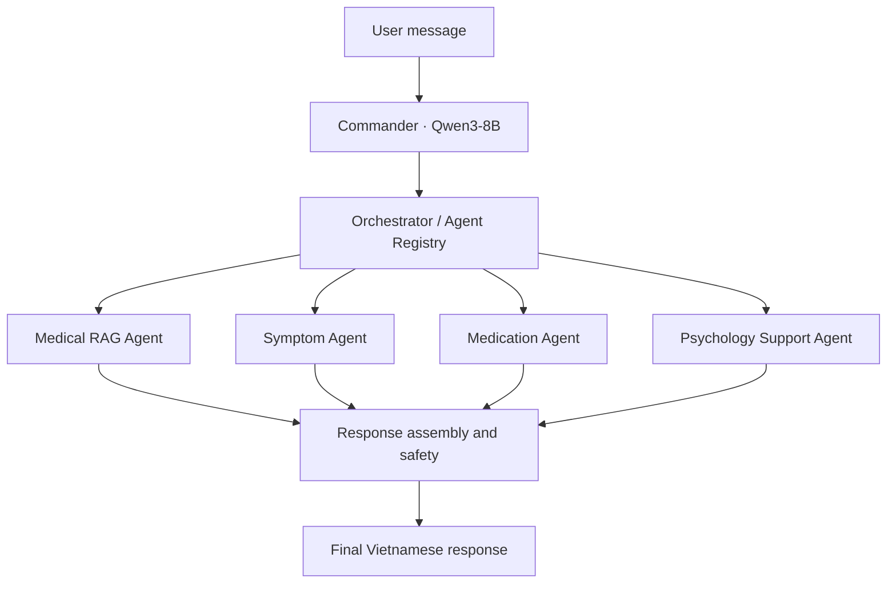

# AI Healthcare — Vietnamese Multi-Agent Medical Assistant

> **Research prototype / MVP in development.** This repository explores evidence-grounded medical question answering and multi-agent orchestration for Vietnamese users. It is **not** a clinically validated medical device and must not be used for diagnosis, treatment decisions, or emergencies.

**Project status:** retrieval foundation and live-index audit completed; evidence-level retrieval, answer-generation/safety evaluation, and full multi-agent integration remain in progress.  
**Last progress update:** 10 November 2026.

---

## 1. Project overview

AI Healthcare is a research-oriented prototype for a Vietnamese healthcare assistant. The longer-term design combines:

- a **Commander / Orchestrator** that interprets a user request and routes work;
- four specialist agents;
- a medical-knowledge RAG pipeline with source provenance and citations;
- a separate patient-record context layer, using synthetic data during development;
- evidence sufficiency, abstention, and safety checks.

The current engineering work is deliberately staged. The project has established the local model/provider foundation, source-backed Medical RAG path, a seven-domain MedlinePlus corpus, Qdrant indexing, provenance validation, and an initial retrieval benchmark. It has **not** yet demonstrated clinically reliable answer generation or completed end-to-end validation of all four specialist agents.

## 2. Target multi-agent architecture



This is a logical routing diagram. The Orchestrator selects the applicable specialist task or tasks; it does not require all four agents to run for every request.


The four specialist responsibilities are:

| Agent | Intended responsibility | Current implementation status |
|---|---|---|
| **Medical RAG Agent** | Retrieve medical knowledge, assemble source-backed evidence, and answer within the evidence available. | A real-source Medical RAG smoke-test path and multi-domain retrieval pipeline have been developed. Full answer-quality evaluation is still pending. |
| **Symptom Agent** | Structure symptom information, identify missing context, and ask clarifying questions. | Specialist role is part of the target design; complete end-to-end validation is pending. |
| **Medication Agent** | Handle bounded medication-information requests and apply medication-safety constraints. | Specialist role is part of the target design; complete end-to-end validation is pending. |
| **Psychology Support Agent** | Provide supportive, non-diagnostic psychological assistance and appropriate escalation. | Specialist role is part of the target design; complete end-to-end validation is pending. |

**Important model distinction:** `qwen3:8b` through Ollama is the confirmed local LLM used by the Commander and in an earlier Medical RAG smoke-test path. `bge-m3` is the embedding model, not a chat model. A final per-agent LLM assignment has not been established; this README does not claim that four separate LLMs are running.

## 3. Current technical architecture

### 3.1 Medical knowledge RAG

```text
MedlinePlus Health Topic summaries
              |
              v
     Source manifest / provenance
              |
              v
    Text normalization and chunking
              |
              v
      BGE-M3 embeddings (1024d)
              |
              v
          Qdrant Server
              |
              v
          Dense retrieval
              |
              v
     Evidence assembly / checking
              |
              v
       LLM answer generation
```

The retrieval evaluation currently measures the retrieval portion of this flow. The seven-domain benchmark does **not** call Qwen to generate answers.

### 3.2 Separation of patient data and medical knowledge

Medical knowledge and patient-specific information are treated as different data types and must not be mixed into one undifferentiated corpus. Development fixtures include synthetic evidence and a synthetic patient record. Real patient records and live hospital/EHR integrations are not part of the current retrieval benchmark.

Missing patient information must not be interpreted as a negative finding. In particular, `NOT ASSESSED` / “CHƯA ĐƯỢC ĐÁNH GIÁ” means that a fact has not been evaluated; it does not mean the fact is absent.

### 3.3 Local models and infrastructure

| Component | Current configuration |
|---|---|
| Commander / local LLM | Ollama `qwen3:8b` |
| Embedding model | Ollama `bge-m3` |
| Embedding dimension | 1024 |
| Vector database | Qdrant Server |
| Qdrant Python client | `qdrant-client==1.20.0` |
| Local endpoints used | Ollama `http://127.0.0.1:11434`; Qdrant `http://127.0.0.1:6333` |
| Main development environment | Windows 11, Python 3.12 virtual environment, VS Code, Docker Desktop |

The model context length, quantization, GPU offload, and concurrent-agent execution affect memory usage. The fact that one local Qwen3-8B process runs successfully does not, by itself, prove that four independent concurrent model processes will fit the machine.

## 4. Medical knowledge corpus and benchmark

### 4.1 Corpus scope

The current multi-domain pilot contains seven MedlinePlus Health Topic `FullSummary` sources:

1. Heart Diseases
2. Type 2 Diabetes
3. Chronic Obstructive Pulmonary Disease (COPD)
4. Gastroesophageal Reflux Disease (GERD)
5. Chronic Kidney Disease (CKD)
6. Migraine
7. Depression

The source manifest is:

- `data/manifests/medlineplus_multidomain_pilot_v0.2.json`
- Manifest version: `0.2`

The corresponding benchmark is:

- `data/evaluation/medical_rag_multidomain_questions_v0.1.json`
- Benchmark version: `0.1.0`
- 28 answerable pilot questions (four per domain)
- 7 out-of-scope diagnostic questions

This is a small engineering pilot, not a representative medical benchmark. One summary per domain provides limited source diversity.

### 4.2 Indexed Qdrant collections

Two independently indexed representations are retained for comparison:

| Collection | Source representation | Points | Composition |
|---|---|---:|---|
| `medical_knowledge_bge_m3_multidomain_pilot_v1` | Captured HTML-derived baseline | 45 | 38 content chunks + 7 document-state records |
| `medical_knowledge_bge_m3_multidomain_plaintext_v1` | Captured plaintext summaries | 39 | 32 content chunks + 7 document-state records |

Both collections use BGE-M3, 1024-dimensional dense vectors, Cosine distance, and the versioned normalization/chunking pipeline documented by their provenance sidecars.

Provenance sidecars:

- `data/manifests/index_builds/baseline_html_v1.provenance.json`
- `data/manifests/index_builds/plaintext_v1.provenance.json`

The evaluator validates the sidecar and checks the live Qdrant payloads against the expected source, normalized content, chunk identity, offsets, metadata, and pipeline configuration. The connection path used by the evaluator is read-only: it connects to an existing collection and refuses to silently create a missing one.

**Provenance qualification:** the available provenance records are retrospectively verified against the current source snapshots and live indexed payloads. Historical model-binary digests and the exact Git commit used at the original indexing moment were not recorded. Therefore, the audit does not claim bit-for-bit historical vector reproducibility.

## 5. Current retrieval results

The following results were produced by the live-audited retrieval runs on 8 November 2026.

| Metric | HTML baseline | Plaintext |
|---|---:|---:|
| Live Qdrant points validated | 45 | 39 |
| Hit@1 | 26/28 (92.9%) | 26/28 (92.9%) |
| Hit@3 | 27/28 (96.4%) | 28/28 (100%) |
| Hit@5 | 28/28 (100%) | 28/28 (100%) |
| MRR@5 | 0.9536 | 0.9643 |
| Top-1 domain accuracy | 92.9% | 92.9% |
| CKD evidence pilot MRR@5 | 0.35 | 0.50 |

Detailed reports:

- `data/evaluation/results/multidomain_retrieval_baseline_live_audit_20261108.json`
- `data/evaluation/results/multidomain_retrieval_plaintext_live_audit_20261108.json`

### How to interpret these numbers

- **Hit@k is document-level.** It checks whether the expected source document appears in the top *k* results. It does not prove that the retrieved chunk contains every fact needed to answer the question.
- **The known-domain-filter run is an oracle diagnostic.** It supplies the expected domain to retrieval and therefore does not measure whether the Commander can independently classify a domain correctly.
- **Similarity scores are not calibrated confidence values.** They are not medical probabilities, answerability scores, or evidence-sufficiency thresholds.
- **Out-of-scope results are retrieval diagnostics only.** The seven out-of-scope questions were sent to nearest-neighbor search; their scores have not been used to establish a safe abstention threshold.

### Preliminary evidence-level pilot

Two manually annotated CKD evidence spans have been evaluated so far. The HTML baseline retrieved the two exact evidence spans at ranks 2 and 5; the plaintext collection retrieved both at rank 2. This is an exploratory two-case result only. It is not sufficient to conclude that plaintext retrieval is generally superior, and the evidence annotation set must be expanded across domains.

## 6. Earlier implementation and validation checkpoints

The following engineering components have also been developed in earlier phases:

- Provider-neutral interfaces for agents, model providers, and retrieval components.
- Commander structured-output handling, JSON/schema validation, and Orchestrator policy validation.
- A local Ollama provider configured for `qwen3:8b`.
- Agent registry and response assembly/orchestration components.
- A source-backed Medical RAG smoke-test path using a MedlinePlus Latex Allergy Health Topic summary.
- Unit/integration test coverage for Commander, orchestration, source-fixture validation, and retrieval-evaluation metrics.

At an earlier Commander evaluation checkpoint, the documented targeted routing set passed 16/16 cases and the then-current test suite passed 57/57 tests. These are software-test results, not clinical performance results.

## 7. Project roadmap and current status

| Milestone | Scope | Status |
|---|---|---|
| 1. Research scope and failure analysis | Literature extraction, failure map, bounded novelty review | Completed as a bounded review; the research novelty claim remains provisional. |
| 2. Corpus and benchmark foundation | Source capture, seven-domain manifest, pilot benchmark | Completed for the current pilot scope. |
| 3. Ingestion and indexing | Normalization, chunking, BGE-M3 embeddings, Qdrant collections | Completed for the two pilot representations. |
| 4. Provenance and initial retrieval evaluation | Sidecar validation, live Qdrant audit, document-level retrieval benchmark | Completed for the current pilot. |
| 5. Evidence Retrieval Evaluation | Expand exact evidence annotations across all seven domains; evaluate evidence rank/coverage | **Next** |
| 6. Answer Generation and Safety Evaluation | Fixed-evidence generation tests, claim support, citation fidelity, completeness, hallucination, abstention | Not yet complete |
| 7. Multi-Agent Integration | Complete and validate Medical RAG, Symptom, Medication, and Psychology Support agents together | Not yet complete |
| 8. End-to-end validation and project packaging | Repeatable full-pipeline tests, final documentation, demo and research report | Not yet complete |

## 8. Running the current retrieval evaluation

### Prerequisites

- The project virtual environment and dependencies are installed.
- Qdrant is already running at `http://127.0.0.1:6333`.
- Ollama is running at `http://127.0.0.1:11434` with `bge-m3` available.
- The target collection has already been indexed. The evaluation command is not an ingestion command.

From the repository root in Windows PowerShell:

```powershell
$env:PYTHONPATH = "src"
```

Run the unit tests for the retrieval metric implementation:

```powershell
.\.venv\Scripts\python.exe -m pytest tests/unit/test_multidomain_retrieval_evaluation.py -v
```

Evaluate the HTML baseline:

```powershell
.\.venv\Scripts\python.exe scripts/evaluate_multidomain_retrieval.py `
  --collection-name medical_knowledge_bge_m3_multidomain_pilot_v1 `
  --provenance data/manifests/index_builds/baseline_html_v1.provenance.json
```

Evaluate the plaintext collection:

```powershell
.\.venv\Scripts\python.exe scripts/evaluate_multidomain_retrieval.py `
  --collection-name medical_knowledge_bge_m3_multidomain_plaintext_v1 `
  --provenance data/manifests/index_builds/plaintext_v1.provenance.json
```

The evaluator validates provenance and the existing live Qdrant payloads before issuing embedding/retrieval queries. It does not create or re-index collections. Evaluation JSON reports are written under `data/evaluation/results/`.

### Earlier real-source Medical RAG smoke test

The repository also contains a one-source integration smoke-test script:

```powershell
$env:PYTHONPATH = "src"
.\.venv\Scripts\python.exe -m pytest tests/unit/test_medlineplus_source_fixture.py -v
.\.venv\Scripts\python.exe scripts/smoke_medical_rag_e2e.py
```

This tests the source-to-answer software path with one MedlinePlus Health Topic summary. It is an integration smoke test, not a broad answer-quality benchmark or clinical validation. Inspect the current branch to confirm that the fixture and script are present before running these commands.

## 9. Known limitations and safety boundaries

1. **Small corpus:** seven summaries do not cover the breadth of medical knowledge or clinical practice.
2. **Small benchmark:** 28 answerable questions are sufficient for an engineering pilot, not broad generalization claims.
3. **Document-level labels:** expected-document retrieval can succeed while the exact required evidence chunk is missing.
4. **Evidence labels are sparse:** only two CKD spans have been manually annotated in the current evidence pilot.
5. **Generation not yet evaluated at scale:** retrieval metrics do not establish that Qwen-generated answers are correct, complete, or supported by citations.
6. **Abstention not validated:** out-of-scope nearest-neighbor scores are not a refusal/abstention test.
7. **Clinical validation absent:** no clinician-led validation study or prospective clinical evaluation is claimed.
8. **No production patient-data integration:** synthetic fixtures are used for development; production authentication, authorization, privacy, security, and EHR integration remain outside the current completed scope.
9. **Novelty is provisional:** the research contribution must remain qualified until the bounded literature review and unresolved direct-overlap risks are adequately addressed.

Do not present this prototype as a diagnostic system, prescribe or recommend medication for a real patient, or use it to delay seeking professional or emergency care.

## 10. Repository structure (high-level)

```text
.
├── data/
│   ├── evaluation/       # Question sets, evidence annotations, evaluation reports
│   ├── manifests/        # Source and index provenance manifests
│   ├── samples/          # Captured source fixtures / pilot corpus
│   └── synthetic/        # Synthetic-only patient and evidence fixtures
├── docs/                 # Architecture, scope, evaluation and phase notes
├── prompts/              # Commander and agent prompts
├── scripts/              # Ingestion, indexing, smoke tests and evaluators
├── src/ai_healthcare/
│   ├── agents/           # Commander and specialist-agent abstractions
│   ├── evaluation/       # Evaluation metrics and helpers
│   ├── ingestion/        # Source validation, normalization and chunking
│   ├── orchestration/    # Registry, orchestration and response assembly
│   ├── providers/        # Ollama / embedding provider interfaces
│   ├── retrieval/        # Dense retrieval
│   ├── schemas/          # Typed data contracts
│   └── vectorstores/     # Qdrant adapters
└── tests/
    ├── unit/
    └── integration/
```

This is a high-level map; some folders and modules may evolve as the implementation progresses.

## 11. Data attribution

The multi-domain pilot uses MedlinePlus Health Topic summaries from the U.S. National Library of Medicine (NLM). Attribute reused Health Topic summary material to **MedlinePlus, National Library of Medicine** and preserve the source URL and last-updated metadata in the source records. Do not assume that reuse permission for Health Topic summaries automatically applies to linked Medical Encyclopedia/A.D.A.M. content or other third-party material; review each source's usage terms before adding it.

## 12. Research and development principles

- Preserve source provenance and distinguish source facts from model-generated text.
- Keep patient-specific facts separate from general medical knowledge.
- Treat missing or unassessed data as unknown, not as a negative finding.
- Evaluate retrieval, evidence selection, answer generation, citation support, and abstention separately.
- Do not infer answerability from vector similarity alone.
- Prefer a reproducible, narrowly scoped experiment over adding agents or modules without a measured need.
- Report negative results and limitations; do not turn a small pilot into a clinical claim.

## 13. License

No repository-wide license is asserted here. Add an explicit project license before inviting reuse or redistribution. Individual datasets and source materials may have their own terms and attribution requirements.
